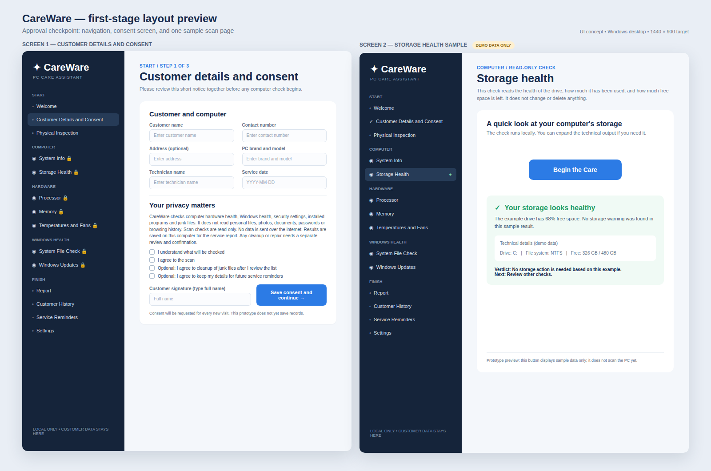

# CareWare

One-click PC cleanup and health checker with friendly, non-techy results and customer PDF and CSV reports.




## Download

[**Download CareWare for Windows**](https://github.com/LouiseCatala/CareWare/releases/latest)

CareWare is available through these official publication channels:

| Channel | Link | Availability |
| --- | --- | --- |
| CareWare website | [Open the official download page](https://louisecatala.github.io/CareWare/) | Available |
| GitHub Releases | [Download the latest Windows installer](https://github.com/LouiseCatala/CareWare/releases/latest) | Available |
| itch.io | [Download CareWare on itch.io](https://louisecatala.itch.io/careware) | Available |


After the WinGet submission is approved, CareWare will also be installable from a terminal with:

```powershell
winget install --id LouiseCatala.CareWare --exact
```

Requires 64-bit Windows 10 or Windows 11 and the Microsoft Edge WebView2 Runtime, which is already included with most Windows installations. The installer will explain what to do if it is missing.

The SHA-256 of each installer is listed in its release notes. Verify it before installing.

## What CareWare does

CareWare makes basic PC health checks easy to understand for everyday computer users. It runs local diagnostics, explains the results in plain language, keeps checkup history on the computer, and offers guarded cleanup tools that require review and permission before anything is removed.

- Simple dashboard for PC checks, cleanup, physical inspection, and reports
- Read-only checks for system information, storage, memory, processor use, Windows health, security settings, devices, startup programs, and more
- Plain-language results marked as passed, needs attention, problem, or unavailable
- Quick, full, and individually selected check modes
- Guarded temporary-file cleanup with separate consent, file review, confirmation, and restore-point verification
- Local checkup history with comparison between recorded visits
- PDF and JSON report export for individual checkups
- CSV export of all saved checkups from Checkup history
- Local reminders, business details, report branding, and database backup and restore

## How to install

1. Click **Download CareWare for Windows** above, then download `CareWare-Setup.exe` from the latest release.
2. Save it somewhere easy to find, such as Downloads.
3. Optional: verify the SHA-256 from the release notes.
4. Double-click `CareWare-Setup.exe`.
5. If Windows shows **Windows protected your PC**, click **More info**, then click **Run anyway**. This appears because the installer is not yet code-signed.
6. Follow the installer window and optionally create a Desktop shortcut.
7. Open **CareWare** from the Desktop shortcut or Start menu.
8. Create a new checkup, review the consent notice, and choose the checks you want to run.

CareWare installs for the current Windows user and does not need a separate Python or Node.js installation.

## Safety and privacy

- Checks are read-only unless the user explicitly enters the cleanup flow.
- Cleanup only targets eligible older files in Windows temporary folders.
- Personal documents, photos, downloads, passwords, and browsing history are never cleanup targets.
- Cleanup starts in dry-run mode and requires recorded permission, a second confirmation, and a verified Windows restore point.
- Missing or unreadable diagnostic information is shown as unavailable, never as healthy.
- Nothing is uploaded. Customer, consent, and scan data stay in the local database in `Documents\CareWare`.

CareWare is a diagnostic aid. It does not replace a qualified technician for hardware failure, data recovery, malware response, or other high-risk repairs.

## Using Checkup history

Open **Checkup history** from the top-right header to:

- Search previous checkups by customer, phone number, or computer
- Compare two recorded checkups
- Export an individual PDF and JSON report
- Click **Export CSV** to save the full history as a spreadsheet-compatible file

## Why CareWare was built

Windows has many useful diagnostic tools, but their results are spread across technical screens written for experienced users. CareWare brings common checks into one focused app and explains the outcome in clear, practical language, without treating every warning as an emergency.

## Development

Built with Python 3.11 and pywebview for the desktop shell, React, TypeScript, Tailwind CSS, and Vite for the interface, SQLite for local records, and ReportLab for PDF reports.

```powershell
py -3.11 -m venv .venv
.\.venv\Scripts\python.exe -m pip install -r requirements.txt
cd ui
npm ci
npm run build
cd ..
.\.venv\Scripts\python.exe main.py
```

Run the automated tests:

```powershell
.\.venv\Scripts\python.exe -m unittest discover -s tests -v
```

The current release passes 24 unit and regression tests, the desktop navigation smoke test, a packaged executable test, dependency audits, and an isolated installer install and uninstall test. See [RELEASE_REVIEW.md](RELEASE_REVIEW.md) for details.

## Building the Windows installer

1. Run `build.bat` on a Windows development machine. It builds the interface, runs the tests, and creates `dist\CareWare\CareWare.exe`.
2. Compile `installer.iss` with Inno Setup to produce `installer_output\CareWare-Setup.exe`.

## License

Released under the MIT License. See the [LICENSE](LICENSE) file.
